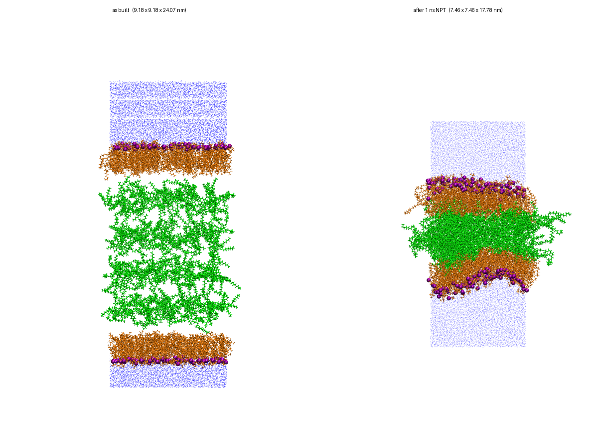
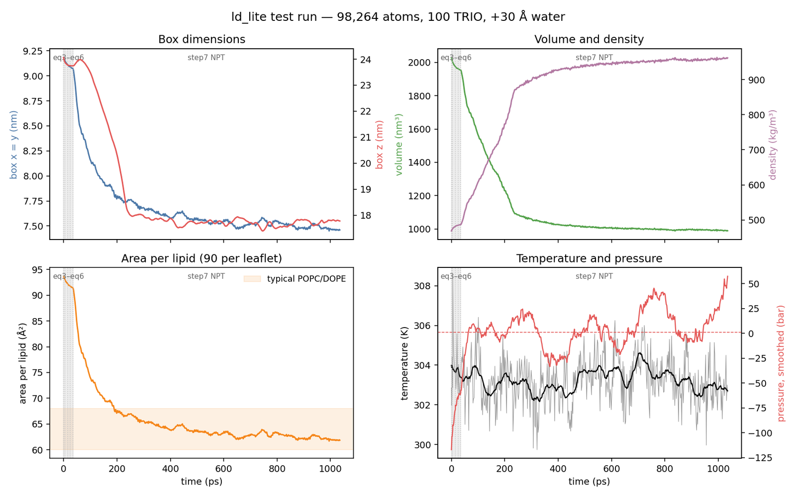

# ld_lite

Turn a lipid bilayer into a **lipid droplet** — an oil (triolein) core between
two phospholipid monolayers — ready to simulate in GROMACS.



## What you need

- A **solvated bilayer** `.gro` (CHARMM-GUI output works as is)
- Your **CHARMM36 `toppar/`** folder, including `TRIO.itp`
- **GROMACS**, for the simulation step

## Install

```bash
pip install .
```

## Run

```bash
# 1. build the droplet (seconds, no GROMACS needed)
ld_lite build --bilayer bilayer.gro --n-trio 100 --out ld1 --toppar toppar/

# 2. minimize, equilibrate, and run NPT production
ld_lite equil ld1 --production
```

That's it. The result is `ld1/npt.gro` and the trajectory `ld1/npt.xtc`.

On a cluster, copy `ld1/` over and run `sbatch run_equil.slurm` instead of step 2
(edit the `FIXME` account/partition lines first). It needs only GROMACS.

## Tips

- **Check the "closest contact" that `build` prints.** If it's under ~1 Å,
  rebuild with a looser core, e.g. `--packing-fraction 0.15`. Otherwise the
  run can crash a few stages in.
- **Test first:** `ld_lite equil ld1 --nsteps 500` runs every stage briefly.
- **Lipid not recognised?** Declare it: `--membrane DPPC`.
- The core starts loose on purpose; the box **shrinks during NPT** as it packs.

## Options

| option | what it does | default |
|---|---|---|
| `--n-trio` | number of triolein molecules in the core | required |
| `--packing-fraction` | how tightly the core starts packed (lower = cleaner, taller box) | 0.25 |
| `--membrane`, `--solvent`, `--core` | declare residues it doesn't know | — |
| `--seed` | random seed for core placement | 0 |
| `--ntomp` (equil) | CPU threads | GROMACS default |
| `--production` (equil) | also run step7 NPT | off |

## Example result

100 TRIO in a 90 POPC / 90 DOPE bilayer with extra water (98,264 atoms), 1 ns NPT
on a laptop CPU: no crashes or warnings, the box shrank 51% as the core packed,
and density rose from 469 to 962 kg/m³.



## More

Cluster details, running `gmx` by hand, how the core is placed, and validation:
**[docs/DETAILS.md](docs/DETAILS.md)**.

Run the tests with `pip install ".[test]"` then `pytest -q`.
